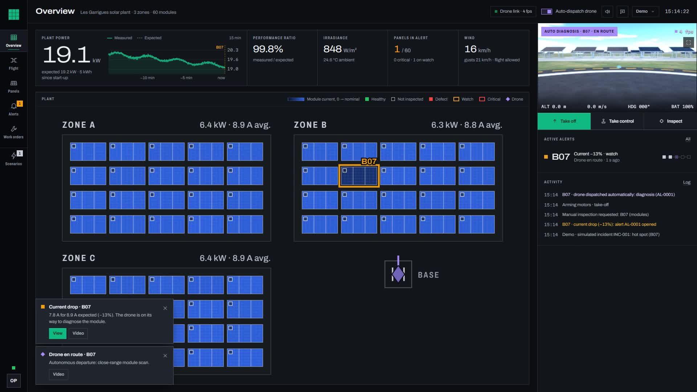
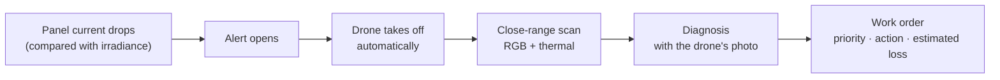
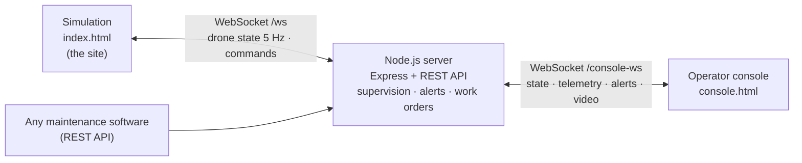

# HelioScan

**Close-range drone inspection for solar plants, and the operator console that turns a fault into a work order.**

Built in 48 hours at **hackTurin 2026** (Turin, 9–11 October 2026) for the **Beyond Solar** challenge.



---

## The problem

A single hot spot, cracked cell or dirty module quietly reduces a plant's output, and it is easy to miss:

- **Manual inspection** means technicians walking the rows with a handheld thermal camera: slow, tiring, and easy to miss things.
- **Fixed camera towers**, usually rented, watch the site, not each cell.
- **High-altitude drone passes** see the big picture, but a single faulty cell is only a few pixels.

## Our approach

HelioScan is an **inspection payload** for a proven, off-the-shelf drone: a stabilised RGB + thermal camera that flies **0.65 m from the glass** and looks at every panel **perpendicular to its surface**, the angle a thermographer would use. Around it, an **operator console** closes the loop for the company running the plant:



This repository runs that whole loop in a browser: a **3D simulation** plays the role of the real site (plant, drone, onboard camera), and the **operator console** supervises it.

---

## Quick start

Requires **Node.js 20.19+ or 22.12+**.

```bash
npm install
npm run dev
```

Open these **in two separate browser windows** (the console's drone video comes from the simulation, so keep it visible):

| Page | URL | Role |
|---|---|---|
| Simulation | http://localhost:3000 | The site: 3 zones, 60 panels, the drone and its camera |
| Operator console | http://localhost:3000/console.html | The plant operator's screen |

To use another port: `PORT=3200 npm run dev` (PowerShell: `$env:PORT=3200; npm run dev`).

### One-minute demo

1. In the console, open **Demo** → speed **×4**, then **Flight** → camera **Thermal**.
2. Go to **Scenarios** → **Hot spot** → module **B07**.
3. Watch it run without touching anything:
   - B07's current drops; after a few seconds an **alert** opens and the module darkens on the map.
   - The drone **takes off by itself**, flies to B07 and scans it at close range (**Flight** view).
   - **Alerts**: the current curve, the start of the alert, and the **drone's photo** of the hot spot.
   - **Work orders**: *Module replacement*, priority, estimated time and power loss. Closing it repairs the module, in the 3D view too.

---

## Features

### 3D simulation (`index.html`)
- **Procedural plant**: 3 zones × 20 panels (A01–C20), structures, terrain, sky. No external assets, works offline.
- **Missions**: whole plant, one zone, one panel, zone overview or any point; serpentine route row by row.
- **Close-range scan**: descent to 0.65 m, gimbal at −60° (perpendicular to the 30° panel), U-shaped pass along both long edges. When a defect comes into view, the drone **holds 5 s** in front of it.
- **Structure inspection**: low flight in the aisles, a stop in front of each leg and foundation (corrosion, bent leg, cracked foundation).
- **Onboard camera**: live RGB or **thermal** (false colour) view with HUD; defects show up as hot areas.
- **Smooth drone motion** without physics: braking profile, limited jerk, tilt from acceleration, stabilised gimbal.
- Speed ×1 to ×8, follow-the-drone camera, mouse and keyboard controls.

### Operator console (`console.html`)
- **Supervision**: plant power (measured vs expected), performance ratio, irradiance, wind, and a map of the 60 modules whose **brightness follows the measured current**.
- **Electrical fault detection**: current is compared with the current expected for the zone's irradiance, so a passing cloud triggers nothing.

  | Deviation from expected current | For | Effect |
  |---|---|---|
  | ≤ −6 % | 4 s | *Watch* alert |
  | ≤ −15 % | 3 s | Escalates to *critical* |
  | > −3 % | 15 s | Alert closed |

- **Automatic dispatch**: the drone leaves on its own, inspects, photographs the anomaly, diagnoses it, creates a work order and returns to base. Critical alerts go first.
- **Alerts**: the *Detection → Drone sent → Inspection → Diagnosis → Work order* chain, current curve, drone photo and timestamped history.
- **Work orders**: created after each diagnosis (action, priority, estimated loss, photo); assign, schedule, close.
- **Flight**: live video, take off, land here, return to base, thermal/visible camera, gimbal pitch, **manual piloting** (keyboard, on-screen sticks or gamepad) with a virtual fence and a dead-man's brake.
- **Notifications**: on-screen banners, sound, browser notifications.

### Demo scenarios
Each scenario places a real incident in the simulation, which is then detected the way it would be on site.

| Family | Scenario | Detected by | What the drone does |
|---|---|---|---|
| Module | Hot spot · cracked cell · soiling · electrical fault | Module current (−12 % to −35 %) | Close-range scan |
| Structure | Abnormal tilt · foundation settling · corrosion | Tilt sensor, weather station | Low pass, stop at each leg |
| Structure | Wind gust (zone) | Anemometer | **Waits for the gusts to end** (flight forbidden above 36 km/h), then inspects |
| Terrain | Heavy rain · vegetation shading · insulation fault · ground subsidence | Rain gauge, row currents, inverter, tilt sensors | Overflight with the camera pointing down |

---

## How it fits together



The server simulates per-module electrical telemetry (current, voltage, power), zone irradiance, temperature, wind and clouds. It runs fault detection and owns the alerts and work orders. The simulation executes the drone commands. The console only talks to the server, so the same console could supervise a real drone.

### Project structure

```
HelioScan/
├─ index.html            3D simulation (the site)
├─ console.html          operator console
├─ server/
│  ├─ server.js          entry point, REST API, WebSockets (simulation ↔ console)
│  ├─ operations.js      electrical supervision, alerts, automatic dispatch, work orders
│  └─ scenarios.js       demo incidents (modules, structures, terrain)
├─ src/
│  ├─ simulation/        scene, terrain, plant, drone, mission logic, onboard camera, side panel, video stream
│  ├─ console/           views, plant map, charts, manual piloting, video, notifications
│  └─ shared/            configuration, utilities, panel drawing
└─ docs/
   ├─ REFERENCE.md       full technical reference (French): controls, mission logic, every API route
   ├─ DESIGN.md          console design system
   └─ PRODUCT.md         product notes
```

All tunable values (plant layout, drone speeds, scan distance, hold time, thermal scale…) live in [`src/shared/config.js`](src/shared/config.js).

---

## REST API

Every action available in the interfaces is also an HTTP call, so HelioScan can be driven by existing maintenance software. A few examples:

| Method | Route | Body | Effect |
|---|---|---|---|
| `GET` | `/api/status` | | Drone, mission, zones and panels |
| `POST` | `/api/goto` | `{ "panel": "B07" }` or `{ "x": 5, "z": -15 }` | Inspect a panel, or fly over a point |
| `POST` | `/api/mission/start` | `{ "zone": "B" }` (optional) | Inspect the whole plant or one zone |
| `POST` | `/api/return` | | Return to base and land |
| `POST` | `/api/thermal` | `{ "on": true }` | Thermal / visible camera |
| `GET` | `/api/scada` | | Electrical telemetry, weather, zones |
| `GET` | `/api/alerts` | | Active alerts and history |
| `GET` | `/api/workorders` | | Work orders |
| `POST` | `/api/demo/scenario` | `{ "id": "hotspot", "panel": "B07" }` | Trigger a simulated incident |

```bash
curl -X POST http://localhost:3000/api/goto -H "Content-Type: application/json" -d '{"panel":"B07"}'
```

The full list (manual piloting, landing, gimbal, alert actions, work order updates, incidents, video frames) is in [`docs/REFERENCE.md`](docs/REFERENCE.md).

---

## Commands

| Command | What it does |
|---|---|
| `npm run dev` | Server, Vite (hot reload) and API on port 3000 |
| `npm run build` | Production build in `dist/` |
| `npm start` | Serves the production build with the API |

## Built with

[three.js](https://threejs.org/) (3D rendering), [Express](https://expressjs.com/) and [ws](https://github.com/websockets/ws) (server, REST API, WebSockets), [Vite](https://vite.dev/) (dev server and build), and the Inter, Archivo and Martian Mono fonts via [Fontsource](https://fontsource.org/). The plant, panels, drone, terrain, textures and sounds are all generated in code.
