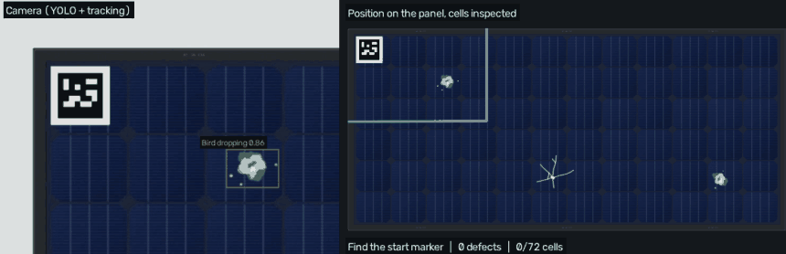
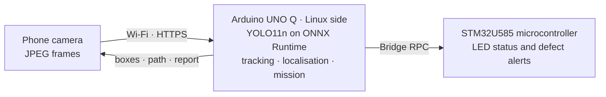
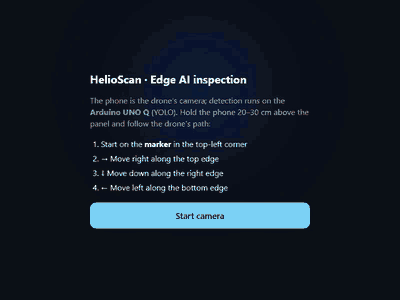
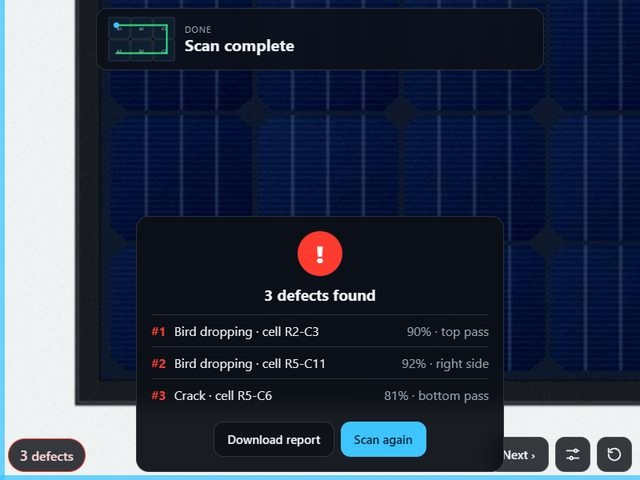
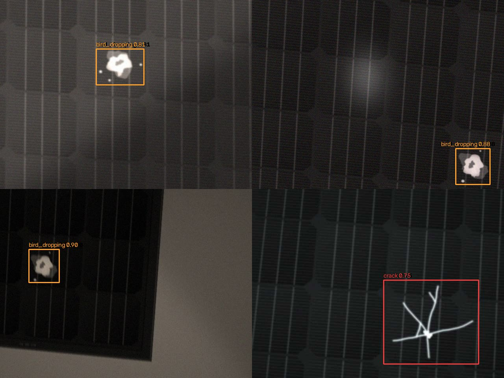
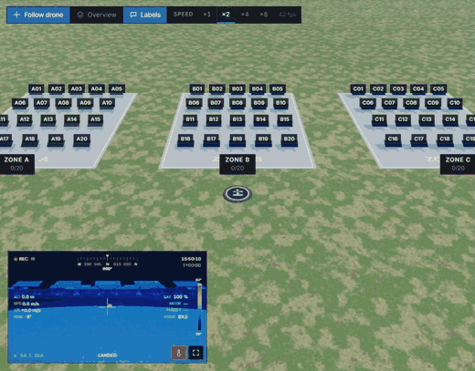
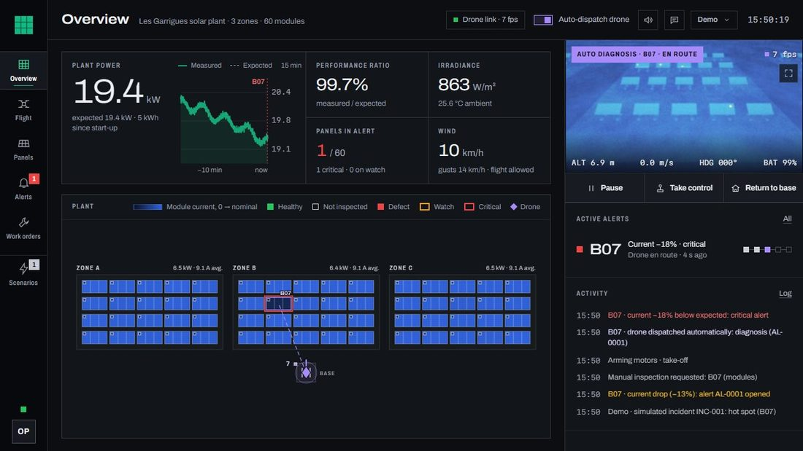
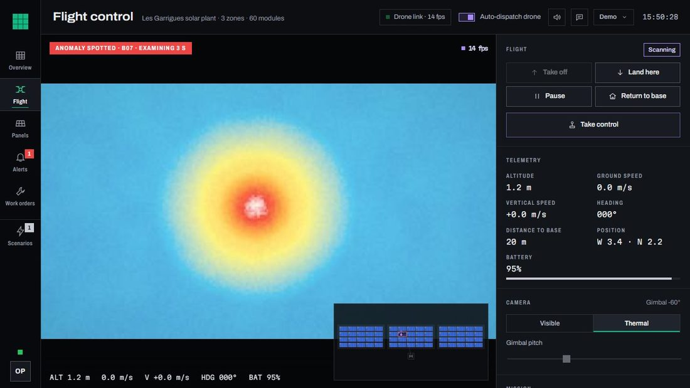
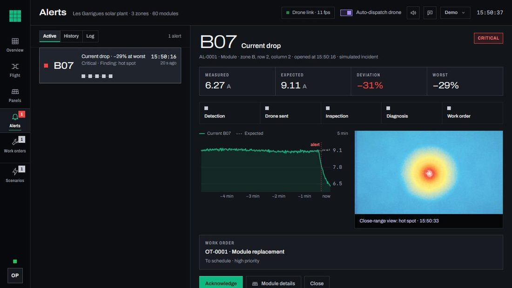
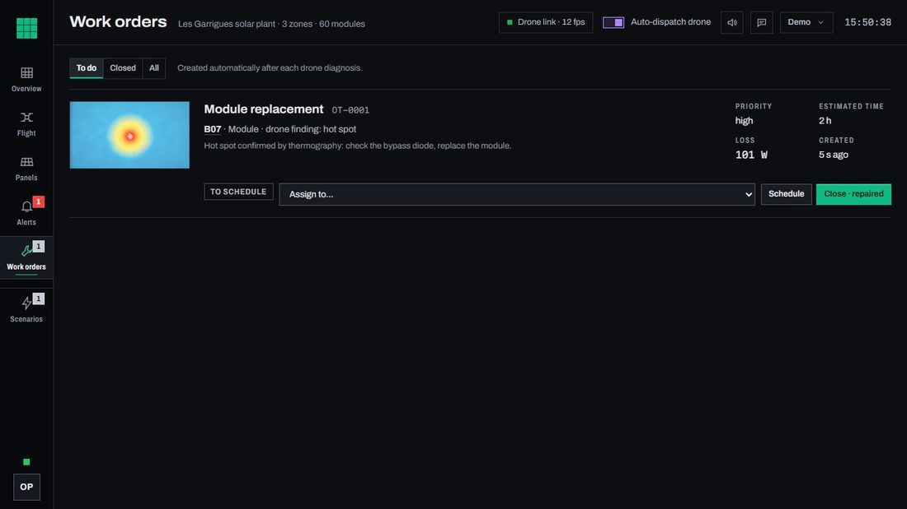

# HelioScan

**On-device YOLO inspection of solar panels on an Arduino UNO Q: no cloud, and every defect placed on the panel in millimetres.**

**3rd place (€500)** at hackTurin 2026 (Turin, 9–11 October 2026, organised by [Apeira](https://apeira.it)), Beyond Solar challenge.
Built by **Yazid Benmchich, Iyad Abid and Camil Bouhafs**.



*A simulated flight along the U path: the camera view on the left, the position on the panel on the right.*

## The idea

Drones already survey solar plants, but from high up a single faulty cell is only a few pixels. We
designed an experimental payload that flies close to each panel and does its vision on board, so
inspection does not depend on a link to the cloud.

This repository is that payload as a working prototype. A phone stands in for the payload camera and a
printed 855 × 396 mm panel stands in for the real one, while **all the perception runs on the UNO Q**.



## The phone app

The phone only streams its camera and draws what the board sends back. It guides the user along the path,
outlines each confirmed defect with its cell, and ends with a report.

| Guided scan | Final report |
|---|---|
|  |  |

## How it works

Each frame goes through one pipeline ([`pipeline.py`](app/python/helioscan/pipeline.py)), and every stage is timed:

| Stage | What it does | Code |
|---|---|---|
| Detection | **YOLO11n** at 320 px on ONNX Runtime, on the board's CPU. Two classes: `bird_dropping`, `crack` | [`detector.py`](app/python/helioscan/detector.py) |
| Tracking | ByteTrack-style association, so a defect seen in 50 frames stays one object | [`tracker.py`](app/python/helioscan/tracker.py) |
| Localisation | ArUco anchor, optical-flow odometry, and ECC registration against a map of the healthy panel | [`localization.py`](app/python/helioscan/localization.py) |
| Mission | The drone's U-shaped coverage path, a defect map in mm, and per-cell coverage | [`mission.py`](app/python/helioscan/mission.py) |
| Microcontroller | The STM32 signals scan state and defect alerts through the Bridge | [`sketch.ino`](app/sketch/sketch.ino) |

More detail in [Architecture](docs/ARCHITECTURE.md) and [Training](docs/TRAINING.md).



## Operator console

The other half of the project is what a plant operator would see. A simulated solar plant and a console
close the loop: a panel's current drops, an alert opens, the drone flies out by itself, confirms the hot
spot in thermal and creates a work order.



| Plant overview | Thermal inspection |
|---|---|
|  |  |
| **Alert with the drone's photo** | **Automatic work order** |
|  |  |

It has [its own README](operator-console/README.md).

## At the hackathon, and after

| At the event | Rebuilt afterwards |
|---|---|
| YOLO11n running on the UNO Q, with the phone as camera | Detector retrained on a procedural dataset, with the printed defects held out |
| Tracking, U-shaped path, STM32 alerts over the Bridge | Localisation and a measured defect map, replacing positions taken from the reference file |
| MLX90621 thermal sensor shown alongside the phone video | Not in this repository: the board-side thermal code was not kept |
| 3D plant simulation and operator console | Moved to [`operator-console/`](operator-console), which has [its own README](operator-console/README.md) |

## Repository

| Path | Content |
|---|---|
| [`app/`](app) | The Arduino App Lab application: Python pipeline, STM32 sketch, phone page, model |
| [`training/`](training) | Procedural dataset generator and YOLO training |
| [`tools/`](tools) | Detector and end-to-end evaluation, local test server, App Lab packaging |
| [`print/`](print) | The two printable panels (6 × A4 sheets each), with defects and healthy |
| [`docs/`](docs) | [Architecture](docs/ARCHITECTURE.md) · [Training](docs/TRAINING.md) · [Deployment](docs/DEPLOYMENT.md) · [Scaling](docs/SCALING.md) |
| [`operator-console/`](operator-console) | Three.js plant simulation and operator console |

## Quick start

**On the UNO Q** (full steps in [Deployment](docs/DEPLOYMENT.md)):

1. Run `python tools/package_app.py` to build `dist/helioscan-edge.zip`.
2. Import the ZIP in Arduino App Lab and press **Run**.
3. On a phone on the same Wi-Fi, open `https://<board-ip>:7000`, accept the certificate and tap **Start camera**.

**On a computer** (same page and pipeline, no board):

```bash
pip install -r tools/requirements-dev.txt
python tools/dev_server.py              # then open https://<computer-ip>:7000 on the phone
python tools/evaluate_pipeline.py --quick
```

**Retrain the model** with the steps in [Training](docs/TRAINING.md#reproduce).

## Demo video

[](https://www.youtube.com/watch?v=zeT1VS2Bglo&t=10s)

---

Model: Ultralytics YOLO11 (AGPL-3.0). Socket.IO client: MIT.
