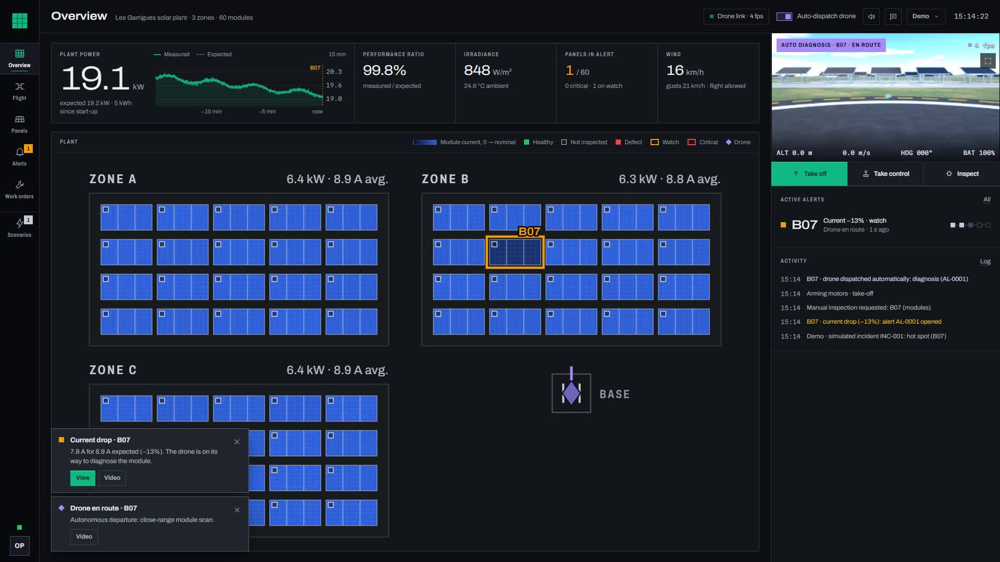
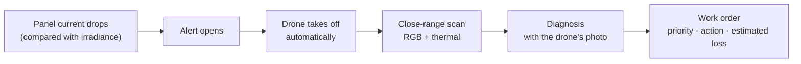
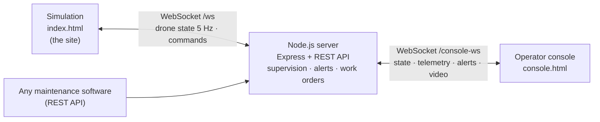

# HelioScan operator console

The plant-side half of [HelioScan](../README.md): a 3D simulation of a solar plant and the console a
plant operator would use, built at hackTurin 2026. It shows the whole loop in a browser, from a drop in
a panel's current to a closed work order. Nothing here touches real hardware: the site, the drone and
the telemetry are simulated. The embedded vision is at the [root of this repository](../README.md).





## Quick start

Requires **Node.js 20.19+ or 22.12+**.

```bash
cd operator-console
npm install
npm run dev
```

Open these **in two separate browser windows**. The simulation owns the plant state, so the REST API
returns `503` until its page is open, and the console's video needs that page to stay visible.

| Page | URL | Role |
|---|---|---|
| Simulation | http://localhost:3000 | The site: 3 zones, 60 panels, the drone and its camera |
| Operator console | http://localhost:3000/console.html | The plant operator's screen |

To use another port: `PORT=3200 npm run dev` (PowerShell: `$env:PORT=3200; npm run dev`).

### One-minute demo

1. In the console, open **Demo** → speed **×4**, then **Flight** → camera **Thermal**.
2. Go to **Scenarios** → **Hot spot** → module **B07**.
3. Watch it run without touching anything:
   - B07's current drops. After a few seconds an **alert** opens and the module darkens on the map.
   - The drone **takes off by itself**, flies to B07 and scans it at close range (**Flight** view).
   - **Alerts**: the current curve, the start of the alert, and the **drone's photo** of the hot spot.
   - **Work orders**: *Module replacement*, priority, estimated time and power loss. Closing it repairs
     the module, in the 3D view too.

## Features

### 3D simulation (`index.html`)

- **Procedural plant**: 3 zones × 20 panels (A01–C20), structures, terrain, sky. No external assets.
- **Missions**: whole plant, one zone, one panel, zone overview or any point.
- **Close-range scan**: descent to 0.65 m, gimbal at −60° (perpendicular to the 30° panel), U-shaped pass
  along both long edges. When a defect comes into view, the drone holds for 5 s in front of it.
- **Structure inspection**: low flight in the aisles, with a stop at each leg and foundation.
- **Onboard camera**: live RGB or simulated thermal view with HUD.
- Speed ×1 to ×8, follow-the-drone camera, mouse and keyboard controls.

### Operator console (`console.html`)

- **Supervision**: plant power (measured vs expected), performance ratio, irradiance, wind, and a map of
  the 60 modules whose brightness follows the measured current.
- **Electrical fault detection**: current is compared with the current expected for the zone's
  irradiance, so a passing cloud triggers nothing.

  | Deviation from expected current | For | Effect |
  |---|---|---|
  | ≤ −6 % | 4 s | *Watch* alert |
  | ≤ −15 % | 3 s | Escalates to *critical* |
  | > −3 % | 15 s | Alert closed |

- **Automatic dispatch**: the drone leaves on its own, inspects, photographs the anomaly, diagnoses it,
  creates a work order and returns to base. Critical alerts go first.
- **Work orders**: created after each diagnosis (action, priority, estimated loss, photo).
- **Flight**: live video, take off, return to base, gimbal pitch, and manual piloting (keyboard, on-screen
  sticks or gamepad) with a virtual fence and a dead-man's brake.

### Demo scenarios

| Family | Scenario | Detected by | What the drone does |
|---|---|---|---|
| Module | Hot spot · cracked cell · soiling · electrical fault | Module current (−12 % to −35 %) | Close-range scan |
| Structure | Abnormal tilt · foundation settling · corrosion | Tilt sensor, weather station | Low pass, stop at each leg |
| Structure | Wind gust (zone) | Anemometer | Waits for the gusts to end, then inspects |
| Terrain | Heavy rain · vegetation shading · insulation fault · ground subsidence | Rain gauge, row currents, inverter, tilt sensors | Overflight with the camera pointing down |

## How it fits together



The server simulates per-module telemetry, weather and clouds, runs fault detection, and owns the alerts
and work orders. The simulation executes the drone commands. The console only talks to the server.

```
operator-console/
├─ index.html            3D simulation (the site)
├─ console.html          operator console
├─ server/
│  ├─ server.js          entry point, REST API, WebSockets
│  ├─ operations.js      electrical supervision, alerts, automatic dispatch, work orders
│  └─ scenarios.js       demo incidents (modules, structures, terrain)
├─ src/
│  ├─ simulation/        scene, plant, drone, mission logic, onboard camera, video stream
│  ├─ console/           views, plant map, charts, manual piloting, video, notifications
│  └─ shared/            configuration, utilities, panel drawing
└─ docs/REFERENCE.md     full technical reference (in French): controls, mission logic, every API route
```

Tunable values (plant layout, drone speeds, scan distance, thermal scale) are in
[`src/shared/config.js`](src/shared/config.js).

## REST API

Every action in the interfaces is also an HTTP call. A few examples:

| Method | Route | Body | Effect |
|---|---|---|---|
| `GET` | `/api/status` | | Drone, mission, zones and panels |
| `POST` | `/api/goto` | `{ "panel": "B07" }` or `{ "x": 5, "z": -15 }` | Inspect a panel, or fly over a point |
| `POST` | `/api/mission/start` | `{ "zone": "B" }` (optional) | Inspect the whole plant or one zone |
| `POST` | `/api/return` | | Return to base and land |
| `GET` | `/api/alerts` | | Active alerts and history |
| `GET` | `/api/workorders` | | Work orders |
| `POST` | `/api/demo/scenario` | `{ "id": "hotspot", "panel": "B07" }` | Trigger a simulated incident |

```bash
curl -X POST http://localhost:3000/api/goto -H "Content-Type: application/json" -d '{"panel":"B07"}'
```

## Commands

| Command | What it does |
|---|---|
| `npm run dev` | Server, Vite (hot reload) and API on port 3000 |
| `npm run build` | Production build in `dist/` |
| `npm start` | Serves the production build with the API |

Built with [three.js](https://threejs.org/), [Express](https://expressjs.com/), [ws](https://github.com/websockets/ws) and [Vite](https://vite.dev/).
